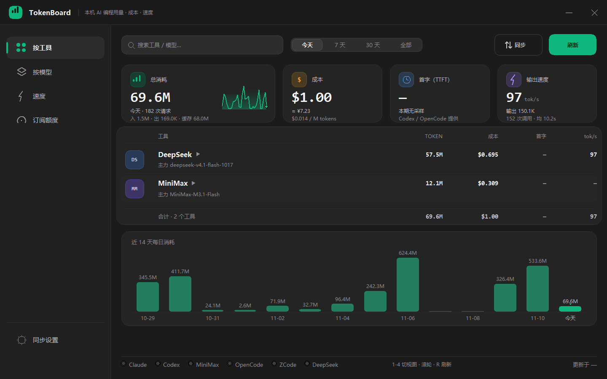

# TokenBoard

本机 AI 编程工具的用量看板 —— 一个轻量桌面托盘插件。

不只是数 token：**同一屏里还能看到花了多少钱、首字等多久、出字有多快**。

思路和 CC Switch 一样（直接读各 IDE 落在本地的会话日志），
**额外补上了 CC Switch 看不到的两个：DeepSeek Harness 和 ZCode**。



---

## 支持的 AI IDE

| 应用 | 本地数据源 | 说明 | 速度数据 |
|---|---|---|---|
| Claude Code | `~/.claude/projects/**/*.jsonl` | 与 CC Switch 同源 | —（日志里只有整段耗时，没有请求级耗时） |
| Codex CLI | `~/.codex/sessions/**/*.jsonl` | 与 CC Switch 同源 | **首字**（`task_complete.time_to_first_token_ms`，按轮） |
| MiniMax Code | `~/.minimax/v2/sqlite/runtime-state.sqlite` | 与 CC Switch 同源 | —（库里没有耗时字段） |
| OpenCode | `~/.local/share/opencode/opencode.db` | 与 CC Switch 同源 | **首字 + 出字速度**（`part` 首个分片时刻） |
| **ZCode** | `~/.zcode/cli/rollout/model-io-*.jsonl` | **CC Switch 不支持，本插件新增** | **出字速度**（`durationMs`） |
| **DeepSeek Harness** | `~/.dsh/sessions/**/session*.jsonl.zstd` | **CC Switch 不支持，本插件新增** | **出字速度**（`step/start` → `assistant/message`） |

> Gemini CLI 与 Antigravity 本机不落盘 token 计数，所以没有纳入。

---

## 轻量：只用原生 Win32，常驻 7MB

面板和托盘**没有用任何第三方 GUI 库**，全部是 `ctypes` 直接调 Win32 API：
GDI 画界面、`Shell_NotifyIcon` 挂托盘、图标像素用纯 Python 算完直接塞进 DIB。

本机实测（`tools/profile_memory.py` / `tools/measure_steady.py`）：

| 程序 | RSS | 私有提交 |
|---|---|---|
| **TokenBoard（原生 Win32）· 稳态** | **7.2 MB** | 17.6 MB |
| TokenBoard · 全量扫描瞬时峰值 | 32 MB | 25 MB |
| TokenBoard（早先用 tkinter + Pillow + pystray） | 65 MB | 37 MB |
| CC Switch（自己 42.5MB + 6 个 WebView2 子进程） | 296 MB | — |
| DeepSeek Harness | 1726 MB | — |
| ZCode | 1058 MB | — |
| MiniMax Code | 3342 MB | — |

比 CC Switch 轻 41 倍。

两个关键点：

1. **不用 tkinter**。光 `import tkinter` 就要 30MB（42.6 - 12.5 的裸 Python 基线），
   Pillow 再加 11MB，pystray 再加 7MB。原生 GDI 一个都不用。
2. **扫描完收缩工作集**。Python 分配器会一直占着释放掉的 arena，
   扫完调一次 `EmptyWorkingSet` 把临时内存还给系统，
   任务管理器里常驻从峰值 32MB 掉回 7MB。
   （私有提交 17-27MB 是分配器保留的可复用 arena，不再涨，但也不会立刻还给系统。）

命令行入口不 import 任何 UI 模块，比 GUI 还省。

---

## 启动

### 免安装版（推荐）

**`TokenBoard.exe`** —— 单个文件，9.5 MB，**复制到任何地方双击就能跑**，不需要装 Python、不需要装任何运行库。

```
dist\portable\TokenBoard.exe
```

已经给你放到 `D:\software\TokenBoard\TokenBoard.exe` 了，双击即用。

### 从源码跑

```powershell
pip install zstandard
python -m tokenboard.app
```

启动后会出现一个横向的小面板，并常驻系统托盘（图标可能在托盘的「^」隐藏区里）。

- 关闭面板（X）→ 收起到托盘，不会退出
- **再点一次启动图标 → 面板会立刻弹回来**（单实例，第二次启动只会唤起已有窗口）
- 托盘图标右键 → 显示/隐藏面板、立即刷新、退出
- 托盘悬停提示会显示今日总量

每分钟自动刷新一次；扫描是增量的，第二次起通常 < 0.2 秒。

> 数据统一存在 `%LOCALAPPDATA%\TokenBoard\tokenboard.db`，
> 所以无论从哪个目录启动，历史数据都是同一份。

### 界面

**Netcatty 风格的中性炭黑 + emerald 强调**：左侧图标导航、顶部大搜索框和主操作按钮、
卡片平铺（没有投影，靠一像素描边和亮度差分层次）、数字一律等宽字体。
颜色只出现在三个地方——主操作（emerald）、工具品牌色图标块、状态语义色，
其余保持中性，不会变成一排红绿灯。

```
┌ TokenBoard ── 本机 AI 编程用量 · 成本 · 速度 ────────────── ─ × ┐
│ 按工具   │  [搜索工具 / 模型…]  [今天|7天|30天|全部]  [同步] [刷新] │
│ 按模型   │ ┌ 总消耗 ─┐ ┌ 成本 ─┐ ┌ 首字 ─┐ ┌ 输出速度 ┐          │
│ 速度     │ │ 67.1M ╱╲ │ │$0.99  │ │  —    │ │ 100 tok/s│          │
│ 订阅额度 │ └─────────┘ └───────┘ └───────┘ └──────────┘          │
│          │  [■蓝] DeepSeek        55.0M   $0.678    —    100     │
│          │  [■紫] MiniMax         12.1M   $0.309    —      —     │
│ 同步设置 │  ● Claude ● Codex ● MiniMax …          更新于 09:07    │
└──────────────────────────────────────────────────────────────────┘
```

- **左侧导航**：按工具 / 按模型 / 速度 / 订阅额度，底部「同步设置」（点了开 WebDAV 配置），
  也可以直接按 `1`-`4` 切换。
- **顶部工具栏**：搜索框（工具名 / 模型名实时过滤）、时间范围、同步、刷新。
- **每行左侧的品牌色图标块**（蓝=DeepSeek、紫=MiniMax……）取各工具自己的品牌色，
  和参考界面里 host 卡的图标块同一套读法：颜色即身份。

四个视图：

| 视图 | 一行是什么 | 点开看到 |
|---|---|---|
| **按工具** | 一个 AI 工具 | 它内部各模型的 token / 成本 / 首字 / 速度 |
| **按模型** | 一个模型（跨工具合并同名） | 它分别在哪些工具里用过 |
| **速度** | 一个模型的首字与吞吐排行 | 该模型在每个工具里的表现 |
| **订阅额度** | 各家订阅剩余额度与重置时间 | —— |

表格固定四列 **TOKEN / 成本 / 首字 / tok/s**，「速度」视图换成 **首字 / tok/s / 输出 / 样本**。
某一格是 `—` 表示这个来源不提供该指标（比如 MiniMax Code 的库里没有耗时字段）。

几个刻意做的取舍：

- **本期没用过的工具不占位置**（比如已经不怎么用的 Claude Code），只在底部状态条留个灯；
  切到「全部」它们会带着历史数据回来。
- 列表是一张**按内容收紧的卡片**，底部固定一行「合计 · N 个工具」；行少的时候下面补一张
  **近 N 天每日消耗**柱状图（N 跟着时间范围走：7 天视图就是 7 根），行多的时候卡片正好铺满内容区。
- 成本按美元算（各家官方价都是 USD），卡片里同时折一个人民币参考值；
  汇率想改设 `TOKENBOARD_CNY_RATE` 即可，不用改代码。

模型视图的合并规则：同一个模型在不同工具里写法可能不一样，统一去掉厂商前缀再合并。

```
deepseek-v4.1-flash  ←  hs/deepseek-v4.1-flash
                        bailian/deepseek-v4.1-flash
                        321/deepseek-v4.1-flash
                        deepseek-v4.1-flash        合计 825.6M
```

条形图的颜色表示这个模型/工具的归属色，跟「按工具」视图的色块一致。
行数超出可视区时**滚轮滚动**，右侧有滚动条指示；也可以用 ↑ ↓ PageUp PageDown Home End 键。

> 滚轮有两个 Win32 坑，插件里都处理了：
> `WM_MOUSEWHEEL` 的增量在 wparam 高 16 位且**是有符号的**（向下滚是 -120），
> 直接 `>> 16` 会算成 65416，一格就能滚 545 行 —— 表现就是"一滚就到底 / 滑不动"；
> 另外滚轮消息只发给**有焦点的窗口**，悬停着滚时焦点往往在别的程序上，
> 所以鼠标一进面板就把它激活。

| 元素 | 作用 |
|---|---|
| 顶部四块指标 | 总消耗 / 成本 / 首字 / 输出速度，都是当前时间范围的汇总 |
| 中间明细表 | 工具或模型的排行，可逐层下钻 |
| 底部状态点 | 绿=该采集源正常，红=报错，灰=未安装。**点一下直接跳到该工具并展开它的模型明细** |

底部那排状态点不只是装饰 —— 它们是**快捷入口**：

- 点 **绿点** → 切到「按工具」视图，滚到那个工具，并直接展开它的模型明细
- 点 **红点** → 同上，底部还会显示该采集源的**具体报错信息**（方便判断是路径变了还是文件被占用）
- 鼠标移到状态点或可展开的行上会变成**手型光标**

桌面小挂件（240×80）也跟着显示成本了：`今天 · 284 次 · $2.17`。

---

## 云同步（WebDAV）

多台机器（家里 + 公司、台式 + 笔记本）可以把用量合到一份看板上。
不需要自建服务：**任何 WebDAV 都能用** —— 坚果云、Nextcloud/ownCloud、
群晖/威联通 NAS、Alist、InfiniCLOUD、自建 Apache `mod_dav` 都行。

### 配置

图形界面：**托盘图标右键 → 「WebDAV 同步设置…」**，填地址 / 账号 / 密码，
勾上「启用云同步」，点「测试连接」确认，再「保存并关闭」。

```
地址       https://dav.jianguoyun.com/dav          （坚果云）
用户名     你的坚果云账号
密码       应用密码（坚果云：账户信息 → 安全选项 → 添加应用密码）
远程目录   TokenBoard
同步间隔   30 分钟
```

也可以走命令行（密码经 DPAPI 加密后才落盘）：

```powershell
python -m tokenboard webdav set --url https://dav.jianguoyun.com/dav `
    --user me@example.com --ask-pass --dir TokenBoard --interval 30 --enable
python -m tokenboard webdav test      # 测试连接（只读，不动远端）
python -m tokenboard webdav sync      # 立刻同步一次
python -m tokenboard webdav status    # 看配置 / 上次结果 / 两端条数
```

自签证书的 NAS 加 `--insecure`（或在界面上勾选）。

> 也可以给 `TokenBoard.exe --sync-settings` 建个快捷方式：已经在跑时会直接
> 让那个实例把设置窗弹到前面（单实例，不会再起一个进程）。

### 工作方式

远端只有一个文件：`<远程目录>/usage.jsonl.gz`（gzip 的 JSONL 快照）。
每次同步：

```
下载远端快照 → 按请求 id 并入本地（已有的不覆盖）
            → 把本地全量重新打包 → 带 If-Match 传回远端
```

- **幂等**：唯一键沿用数据库约束（用量 `(app, request_id)`、速度
  `(app, sample_id)`），同一批数据反复合并不会把数字刷大。
- **并发保护**：下载时记住 ETag，上传带 `If-Match`；远端中途被别的机器
  改过会返回 412，这时重新下载合并再传，最多三轮。没有 ETag 的服务器
  退化成「后写覆盖」，但下一次同步会用自己的全量数据补齐。
- **省流量**：本地行数/最大 id 没变、远端也没有新数据时，直接跳过上传。
- **失败退避**：失败后按「上次尝试时间 + 同步间隔」再试，不会每分钟重打。

### 传什么、不传什么

只传 `usage_events` 与 `speed_samples` 两张表的统计明细。
**不含任何 API Key、不含价格表、不含同步密码**；同步密码只存在本机的
`%LOCALAPPDATA%\TokenBoard\sync.json`，用 Windows DPAPI 加密。
其余机器合并进来的记录也会显示在「按工具 / 按模型」里，数字和直接采集的
完全一样（因为都落同一张表、走同一套聚合）。

### 常见问题

| 现象 | 原因 |
|---|---|
| `401/403 认证失败` | 坚果云要用**应用密码**，不是登录密码；或 WebDAV 没开 |
| `404 远端路径不存在` | 地址多/少了一层路径（Nextcloud 是 `/remote.php/dav/files/<用户名>`） |
| 连接超时 | 公司网络挡了 WebDAV；换端口或改走家里网络 |
| 两边数字对不上 | 看「立即同步」后的提示：`下载 N 条` 才算拉到新数据 |

---

## 命令行

```powershell
python -m tokenboard scan              # 扫描各 IDE 日志并入库（同时采速度）
python -m tokenboard report            # 报表：按工具 + 按模型，带费用 / 首字 / 吞吐
python -m tokenboard report --days 7   # 只看最近 7 天
python -m tokenboard reset             # 清空库，下次全量重扫
python -m tokenboard pricing gpt-5.6-sol   # 查模型单价
python -m tokenboard startup install   # 添加开机自启
python -m tokenboard startup uninstall # 移除开机自启
python -m tokenboard webdav set --url ... --user ... --ask-pass --enable
python -m tokenboard webdav test|sync|status   # WebDAV 云同步
```

启动时也可以直接指定视图：`set TOKENBOARD_VIEW=speed && python -m tokenboard.app`
（可选 `app` / `model` / `speed` / `quota`），时间范围用 `TOKENBOARD_PERIOD=today|7|30|all`。

> 命令行不加载任何 UI 模块，比 GUI 还省。

---

## 数据与隐私

- **采集是只读的**：只读各 IDE 自己的日志文件，不改动、不上传。
- 联网只有两处，且都可关：**订阅额度查询**（只读本机登录态，默认开启）和
  **WebDAV 云同步**（默认关闭，只有你自己点了启用才会上传）。
- 数据全部存在本机：`%LOCALAPPDATA%\TokenBoard\tokenboard.db`（SQLite）
- 日志：`%LOCALAPPDATA%\TokenBoard\tokenboard.log`

---

## 准确性

采集结果与 CC Switch 逐日逐请求对照（同一台机器、同一批日志）：

| 应用 | 请求数一致率 | token 一致率 |
|---|---|---|
| Claude Code | 316 / 316 = **100%** | 100%（各项求和完全相同） |
| OpenCode | 3784 / 3784 = **100%** | 100%（各项求和完全相同） |
| Codex CLI | 2734 / 2732 = **99.93%** | 缓存读 95.9% |
| MiniMax Code | 99.0% | 99.45% |

ZCode 与 DeepSeek Harness 没有可对照的基准（CC Switch 本来就看不到它们）。

### 统计口径

各家的 token 口径不一样，本插件统一折算成：

```
总 token = 不含缓存的输入 + 输出 + 缓存读 + 缓存写
```

其中 **Codex 用的是 OpenAI 口径**（`input_tokens` 已经包含 `cached_input_tokens`），
采集时会先减掉缓存再单独记到「缓存读」，否则缓存会被重复算一次、费用也会翻倍。
其余几家都是 Anthropic 口径（input 不含缓存），无需处理。

### 成本口径

每条请求入库时按 `data/pricing.json`（各模型 input / output / cache-read / cache-write 单价）
算一次 `cost_usd` 一起存下来，看板直接 SUM，不再二次解析价格表：

```
费用 = (输入×单价 + 输出×单价 + 缓存读×单价 + 缓存写×单价) / 1,000,000
```

模型名先做归一化匹配（去厂商前缀、去 `-preview/-flash/-high` 这类后缀、去日期尾巴），
匹配不到再按「家族前缀」回退，所以新出的同族模型不会一下子变成 $0。
MiniMax Code 库里的 `cost_usd` 恒为 0，费用也走这张表算。

### 速度口径

速度单独一张 `speed_samples` 表存，**不混进用量表** —— 两边粒度不一样，
混在一起 token 有被重复累加的风险：

| 来源 | 首字（TTFT） | 耗时 / 吞吐 | 粒度 |
|---|---|---|---|
| Codex CLI | `time_to_first_token_ms` | `duration_ms`（含工具调用） | 一轮（一个 prompt） |
| OpenCode | 首个 `part` 落盘时刻 − 消息创建时刻 | 消息创建 → 完成 | 单次模型调用 |
| ZCode | — | `durationMs` | 单次模型调用 |
| DeepSeek Harness | — | `step/start` → `assistant/message` | 单次模型调用 |

- **首字**取中位数（P50）和 P90；**吞吐** = 输出 token 合计 ÷ 耗时合计，只用「单次调用」级采样，
  因为轮级耗时里混着工具执行时间，会把速度算低。
- 采样表按 `(app, sample_id)` upsert 覆盖：OpenCode 的分片是流式追加的，
  消息刚创建时还看不到首字，下一轮扫描会把 0 补成真实值。
- 升级后会**自动清一次扫描水位**做全量回填（`app_meta.speed_backfill_v2` 标记），
  否则历史日志早被增量水位跳过，首字/耗时永远是空的。

### 升级注意

新增「成本 / 首字 / 速度」后，数据库多了 `speed_samples` 表和一次全量回填；
用旧的 `TokenBoard.exe` 读新库没问题（只是看不到新指标），反过来则不行。

---

## 项目结构

```
tokenboard/
├── app.py              入口：装配 store / scanner / 面板 / 托盘
├── cli.py              命令行
├── config.py           路径与应用元信息
├── models.py           UsageRecord（用量）+ SpeedSample（首字/耗时采样）
├── store.py            SQLite 存储（用量事件 + 速度采样 + 同步水位）
├── pricing.py          模型价格解析
├── scanner.py          扫描调度（扫完收缩工作集）
├── ipc.py              单实例 / 二次启动唤起
├── startup.py          开机自启
├── webdav.py           WebDAV 客户端（GET/PUT/PROPFIND/MKCOL + ETag）
├── sync.py             云同步：配置 / 快照导出解析 / 双向合并
├── icon.py             托盘图标（纯 Python 生成像素）
├── install.py          安装/卸载（快捷方式 + 注册表）
├── collectors/         各 IDE 采集器
│   ├── claude.py  codex.py  mcode.py
│   └── opencode.py zcode.py dsh.py
├── ui/
│   ├── panel.py        主面板（原生 Win32）
│   ├── win32.py        Win32 封装：窗口 / GDI 画布 / 字体
│   ├── tray.py         原生托盘（Shell_NotifyIcon）
│   ├── syncwin.py      WebDAV 同步设置窗口
│   └── theme.py        iOS 配色与字体
└── data/pricing.json   价格表（取自 CC Switch 的 model_pricing，并补齐本机实际用到的模型）

installer/              安装器（PyInstaller 打包成单文件 Setup.exe）
run_gui.py              打包入口
build.ps1               一键打包
tools/                  逆向、验收与内存剖析脚本
```

---

## 依赖

- Python 3.10+
- `zstandard` —— 读 DeepSeek Harness 的 zstd 会话日志（唯一的第三方依赖）

```powershell
pip install zstandard
```

界面与托盘只用标准库 `ctypes`，不需要 tkinter / Pillow / pystray。

## 自己打包

```powershell
pip install pyinstaller
.\build.ps1
```

产物在 `dist/`：

| 文件 | 说明 |
|---|---|
| `portable/TokenBoard.exe` | **免安装单文件版（9.5 MB），放哪都能双击跑** |
| `TokenBoard-Setup-1.0.0.exe` | 单文件安装器（18 MB），以后要做安装包时用 |
| `TokenBoard-1.0.0-portable.zip` | 免安装版压缩包（9.3 MB） |
| `TokenBoard/` | 应用目录版（onedir，启动最快） |

免安装版是 **onefile** 模式：启动时先把内容解压到 `%TEMP%` 再跑。
好处是只有一个文件随便拷；代价是启动慢一点、常驻多一个引导进程：

| 版本 | 文件 | 启动 | 常驻内存 |
|---|---|---|---|
| **免安装单文件** `portable/TokenBoard.exe` | 1 个文件 9.5 MB | ~2 s | ~20 MB（应用 9.6 + 引导进程 12.3） |
| 应用目录版 `dist/TokenBoard\` | 文件夹 22 MB | 瞬开 | ~9 MB（单进程） |

两个都远小于 CC Switch 的 296 MB。**要省内存就用目录版，要一个文件就用单文件版。**

安装/卸载逻辑在 `tokenboard/install.py`（复制文件 + PowerShell 建快捷方式 +
写「应用和功能」注册表项），安装器入口在 `installer/setup_main.py`。

---

## 各采集源的实现要点

踩过的坑，都写在对应采集器的文件头注释里了，这里汇总一下：

- **Claude Code**：同一条 assistant 消息可能被多次写入（流式更新），按 `requestId` 去重并保留 token 最大的一条。
- **Codex CLI**：`token_usage_record` 与 `event_msg/token_count` 描述的是**同一批请求**（token 四元组一致、时间戳相差几毫秒），但旧版本只写后者、新版本只写前者，所以取并集再按「四元组 + 时间邻近」去重。
- **MiniMax Code**：`model` 列为 NULL，模型名在 `local_runtime_sessions.extra_data_json.effectiveModel`，要按 session 关联；`cost_usd` 恒为 0。
- **OpenCode**：`message.data` 是 JSON 字符串，`tokens.cache.read/write` 才是缓存部分。
- **ZCode**：`response.usage` 是驼峰口径且常漏掉缓存读，`response.providerMetadata.anthropic.usage` 是上游原始口径更全，两边取大值。
- **DeepSeek Harness**：会话日志是**多帧 zstd 拼接流**，必须用 `stream_reader(read_across_frames=True)`，否则只能读到第一帧的 session 头；每行的 `data` 还是嵌套的 JSON 字符串要二次解析；`data.stream[N].chunk.usage` 与 `data.usage` 是同一份数据，不能重复累加。

---

## 原生 Win32 的几个坑

写在 `ui/win32.py` 里，这里也记一笔：

- **`ctypes` 默认把返回值/参数当 `c_int`**，64 位句柄会被截断，必须逐个声明 `restype` / `argtypes`。
- **`DrawTextW` 是 5 个参数** `(hdc, text, cchText, lprc, uFormat)`，少传一个会整体错位（把 uFormat 当成 RECT 指针去解引用，直接 access violation）。
- **窗口尺寸要用 `AdjustWindowRectEx` 反推**，否则标题栏会把客户区底部吃掉一截。
- **中文字体一加载就占十几 MB**，这是省不掉的部分（界面是中文的）。
- **读大 SQLite 要关 mmap**：`opencode.db` 有 300MB+，用 `PRAGMA mmap_size=0` + `cache_size=-2000` 才不会把文件映射进内存。